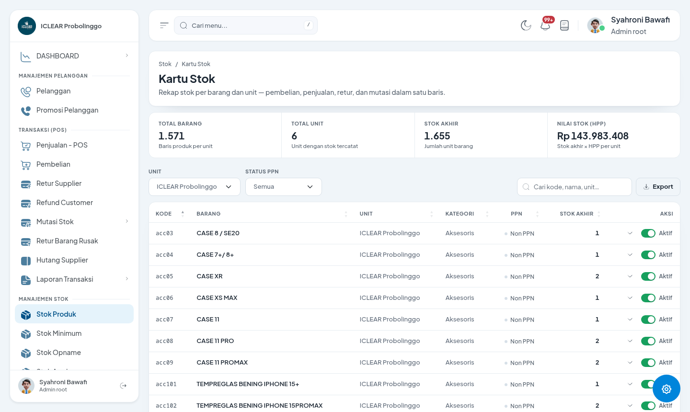
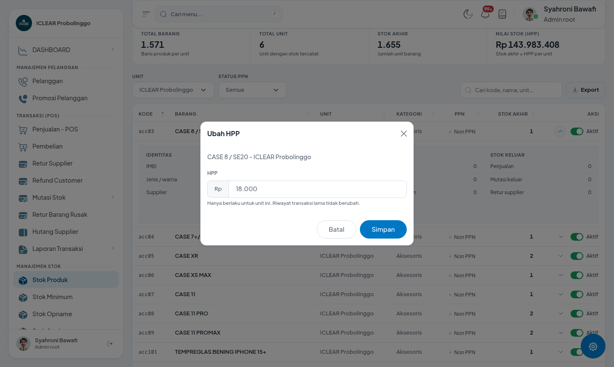
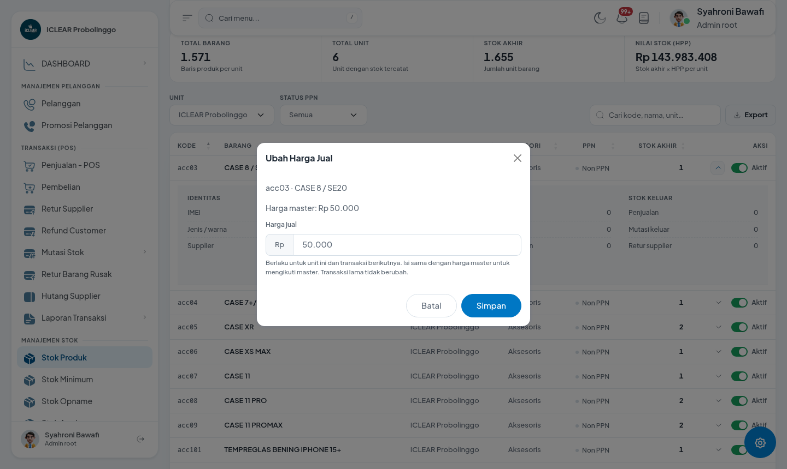
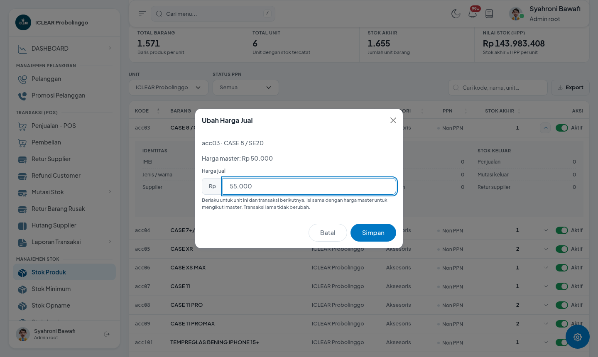
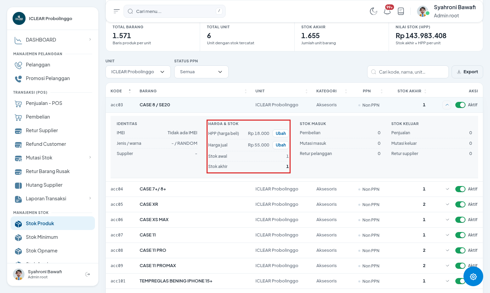
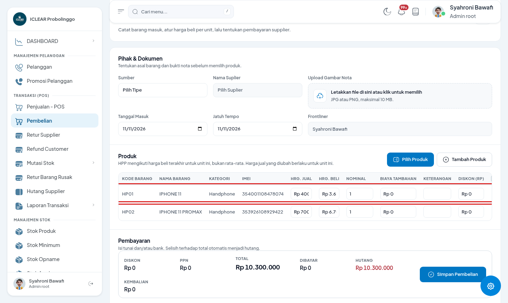
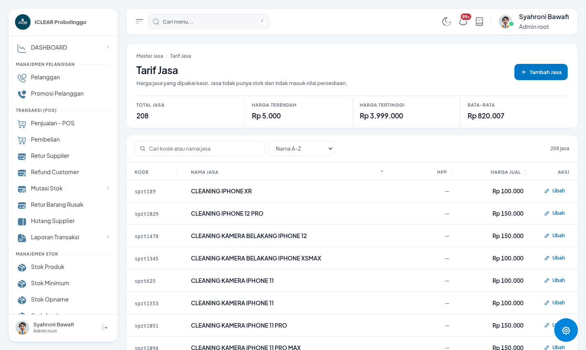
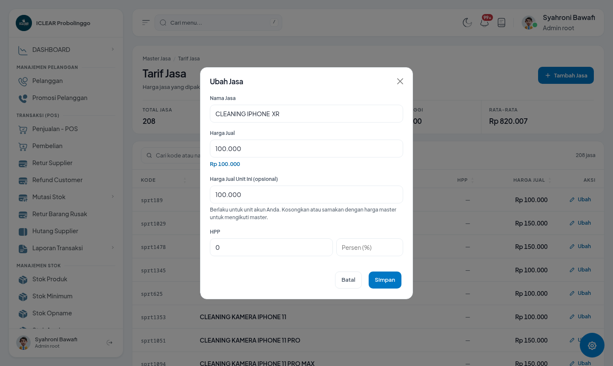
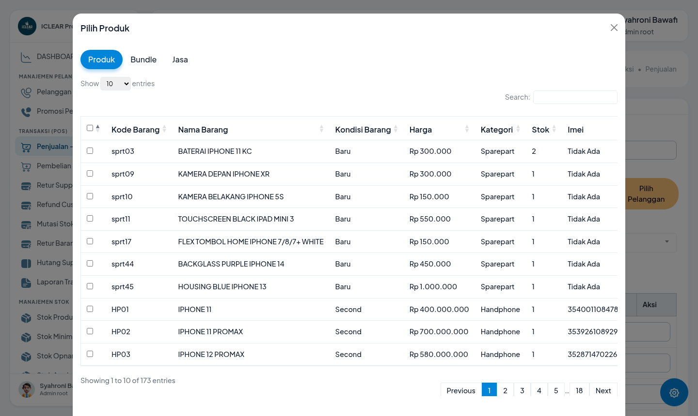
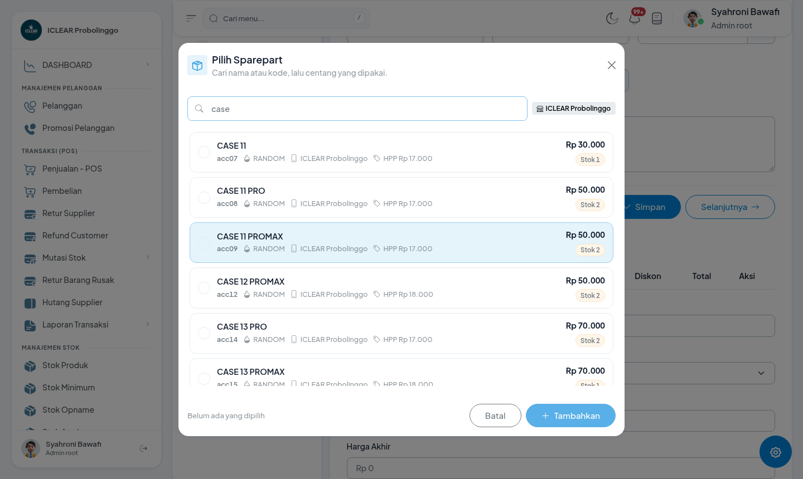

# Panduan Perubahan: HPP (Harga Beli) & Harga Jual per Unit

- **Tanggal:** 11 November 2026
- **Untuk:** Admin toko, kepala toko, kasir, staf gudang
- **Berlaku untuk:** semua unit/cabang
- **Catatan gambar:** semua gambar diambil dari aplikasi asli (contoh: unit *ICLEAR Probolinggo*). Angka yang terlihat adalah data contoh.

---

## 1. Apa yang berubah?

Sebelumnya, satu produk punya **satu HPP dan satu harga jual untuk semua unit**. Sekarang, HPP dan harga jual **bisa berbeda antar unit**. Harga "master" tetap ada sebagai harga dasar — kalau sebuah unit tidak punya setelan khusus, unit itu otomatis memakai harga master.

| Hal | Sebelum | Sesudah |
|---|---|---|
| HPP (harga beli) | Satu nilai per produk, semua unit sama | Mengikuti harga beli terakhir di unit masing-masing; bisa dikoreksi manual per unit |
| Harga jual | Satu nilai per produk | Harga master + harga khusus per unit |
| Kasir (POS) | Memakai harga master | Otomatis memakai harga jual unit tersebut |
| Service (sparepart & jasa) | Memakai harga master | Memakai harga & HPP unit tempat service dikerjakan |
| Transaksi lama | — | **Tidak berubah sama sekali** |

## 2. Siapa yang boleh mengubah?

Hanya role tertentu boleh mengubah HPP dan harga jual per unit:

- Finance
- Admin root
- Manager
- Admin / Kasir
- Kepala Toko

Kalau tombol **Ubah** tidak muncul di layar kamu, berarti akun kamu belum punya hak tersebut — hubungi admin. Kamu tetap bisa **melihat** semua harga dan HPP.

---

## 3. HPP per unit — sebagian besar sudah otomatis

HPP sebuah produk di satu unit **ter-update otomatis** setiap ada pembelian masuk di unit itu (mengikuti harga beli terakhir di unit tersebut). Jadi untuk pemakaian normal, **kamu tidak perlu melakukan apa pun**.

Yang perlu kamu tahu:

- Nilai HPP per unit terlihat di menu **Stok Produk → Kartu Stok** (klik baris produk untuk membuka detail).
- Kartu dashboard **NILAI STOK (HPP)** sekarang dihitung dari *stok akhir × HPP per unit*, jadi lebih akurat per cabang.

### Kalau perlu koreksi HPP manual (hanya untuk unit itu)

1. Buka **Stok Produk → Kartu Stok**.
2. Klik baris produk yang mau dikoreksi → akan terbuka detail produk.
3. Di bagian **Harga & Stok**, klik **Ubah** pada baris *HPP (harga beli)*.

4. Isi HPP yang benar, lalu klik **Simpan**.

> **Penting:** koreksi HPP hanya berlaku untuk unit itu saja. Riwayat transaksi yang sudah terjadi **tidak berubah**.

---

## 4. Harga jual per unit — cara kerja singkat

Setiap produk punya:

- **Harga master** — harga dasar dari master Produk (atau Tarif Jasa).
- **Harga unit** — setelan khusus per unit. Kalau kosong atau nilainya sama dengan harga master, unit tersebut **ikut harga master**.

Yang bisa mengubah harga unit: **Kartu Stok**, **Pembelian**, dan **Tarif Jasa** (untuk jasa).

### 4a. Mengubah harga jual dari Kartu Stok

1. Buka **Stok Produk → Kartu Stok**, klik baris produk.
2. Di bagian **Harga & Stok**, klik **Ubah** pada baris *Harga jual*.
3. Modal menampilkan **harga master** sebagai acuan. Isi harga jual baru untuk unit ini, lalu **Simpan**.

Setelah disimpan, harga jual unit itu langsung berubah (contoh: dari Rp 50.000 menjadi Rp 55.000):

- Untuk **kembali mengikuti harga master**: isi modal dengan angka yang **sama dengan harga master** (atau kosongkan pada Tarif Jasa), lalu simpan. Setelan khusus akan dihapus.
- Harga jual baru hanya berlaku untuk **transaksi berikutnya** di unit tersebut.

### 4b. Mengubah harga jual dari Pembelian

Saat input pembelian, kolom **Hrg. Jual** pada tabel produk bisa diubah (hanya role pengelola) — harga jual itu langsung berlaku untuk unit tempat pembelian, tanpa mengubah harga master produk.

> Rincian lengkap halaman Pembelian ada di dokumen terpisah: **Panduan Perubahan: Halaman Pembelian**.

### 4c. Mengubah harga jual jasa dari Tarif Jasa

Untuk produk jenis **jasa** (bukan sparepart):

1. Buka **Master Jasa → Tarif Jasa**.
2. Klik **Ubah** pada jasa yang mau diubah.
3. Modal memiliki field **Harga Jual Unit Ini (opsional)** — berlaku untuk unit akun kamu. Kosongkan atau samakan dengan harga master untuk mengikuti master.

---

## 5. Di kasir (POS) dan Service: otomatis

**Tidak ada langkah baru untuk harga.** Waktu kasir memilih produk di **Penjualan - POS**, atau teknisi memilih sparepart/jasa di **Service**, sistem otomatis memakai **harga jual dan HPP milik unit tersebut** (bukan harga master). Langkah memilih jasa di Service ada di bagian 6.

---

## 6. Memilih jasa di Service (Terima & Proses Service)

Di langkah **Sparepart** pada service ada dua tombol: **Pilih Sparepart** dan **Pilih Jasa**. Keduanya menambah baris ke tagihan service, tapi sumbernya berbeda:

| Hal | Sparepart | Jasa |
|---|---|---|
| Sumber data | Produk/sparepart yang ada di stok unit | Master Jasa → Tarif Jasa |
| Syarat tampil | Harus ada stok di unit tersebut | Tidak butuh stok |
| Pengaruh stok | Mengurangi stok unit saat transaksi | **Tidak mengurangi stok** |
| Harga | Harga jual unit (atau master) | Harga jual unit jasa (atau master) |

Jadi kalau pekerjaannya berupa jasa (mis. ganti LCD, cleaning, jasa mesin), pilih lewat **Pilih Jasa**. Kalau barangnya sparepart fisik yang diambil dari stok, pilih lewat **Pilih Sparepart**. Jasa hanya muncul kalau sudah dibuat di **Master Jasa → Tarif Jasa** (bagian 4c).

### 6a. Saat Terima Service

1. Buka menu **Terima Service**.
2. Lengkapi langkah **1 Pelanggan** lalu **2 Kerusakan** seperti biasa (klik **Selanjutnya** di tiap langkah).
3. Di langkah **3 Sparepart**, klik tombol **Pilih Jasa**.
4. Ketik minimal 2 karakter nama atau kode jasa, lalu **centang** jasa yang dipakai.
5. Klik **Tambahkan**. Ulangi kalau ada lebih dari satu jasa.
6. Klik **Selanjutnya** untuk menyimpan dan lanjut ke langkah Pembayaran.

Di daftar, baris jasa ditandai **Jasa**, bukan angka stok. Total harga ikut dihitung setelah jasa ditambahkan.

### 6b. Saat edit di Proses Service

1. Buka menu **Proses Service** (atau **Riwayat Service**).
2. Cari service yang mau diubah.
3. Klik tombol **Edit kerusakan & sparepart** pada baris service tersebut — halaman detail terbuka di tab **Sparepart**.
4. Klik **Pilih Jasa**, ketik nama/kode jasa, centang jasanya, lalu **Tambahkan**.
5. Klik **Selanjutnya** untuk menyimpan perubahan.

Menyimpan langkah Sparepart akan **menyusun ulang rincian tagihan/invoice service** dari pilihan terbaru (sparepart + jasa). Pastikan centang pilihan sudah benar sebelum menyimpan.

### 6c. Yang perlu diketahui

- **Jasa tidak menyentuh stok.** Jasa tidak muncul di Kartu Stok, tidak ikut stok opname, dan tidak menambah/mengurangi stok unit.
- **Service yang sudah direfund tidak bisa diubah.** Muncul pesan *“Service sudah direfund; sparepart tidak dapat diubah.”* — hubungi admin/keuangan untuk penanganannya.
- **Sparepart hanya yang ada stoknya.** Kalau sparepart tidak muncul, cek stok unit dan status produk di Kartu Stok. Jasa tidak terpengaruh stok.
- Harga dan HPP jasa tetap mengikuti setelan unit (bagian 5); transaksi lama tidak berubah.

### 6d. Kalau jasa tidak muncul di picker

1. Pastikan kamu menekan tombol **Pilih Jasa**, bukan **Pilih Sparepart**.
2. Ketik minimal **2 karakter** nama atau kode jasa.
3. Pastikan jasanya sudah dibuat di **Master Jasa → Tarif Jasa**.
4. Kalau tetap kosong, hubungi admin untuk mengecek master jasa.

---

## 7. Catatan penting

- **Transaksi lama tidak berubah.** Harga yang sudah tercatat di nota/transaksi sebelumnya tetap seperti aslinya.
- **HPP dan harga jual itu terpisah.** Mengubah harga jual tidak mengubah HPP, dan sebaliknya.
- **Harga master aman.** Setelan harga per unit tidak menimpa harga master di master Produk/Tarif Jasa.
- Nilai stok di dashboard dan laporan HPP kini memakai **HPP per unit**.

## 8. FAQ singkat

**Kenapa harga di kasir beda dengan harga di master produk?**
Karena unit tersebut punya harga jual khusus. Cek di Kartu Stok (klik baris produk, lihat *Harga jual* vs *Harga master*).

**Bagaimana cara mengembalikan harga ke master?**
Di Kartu Stok, ubah harga jual dengan angka yang sama seperti harga master. Di Tarif Jasa, kosongkan field *Harga Jual Unit Ini*.

**Tombol Ubah tidak muncul — kenapa?**
Akun kamu belum termasuk role yang berhak (Finance, Admin root, Manager, Admin/Kasir, Kepala Toko).

**Apakah HPP jasa juga per unit?**
Ya. HPP jasa diatur di Tarif Jasa (nominal atau persen), dan berlaku per unit.

**Kalau saya salah isi harga, transaksi lama ikut berubah?**
Tidak. Yang berubah hanya transaksi baru di unit tersebut.

---

*Dokumen terkait: **Panduan Perubahan: Halaman Pembelian** (`2026-11-11-pembelian.md`) untuk alur pembelian dan hutang supplier.*
