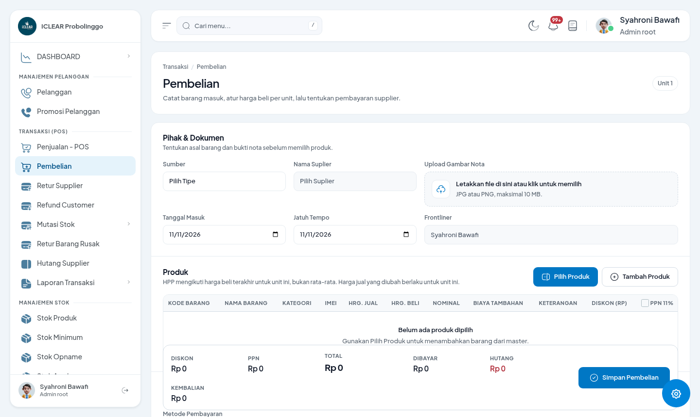
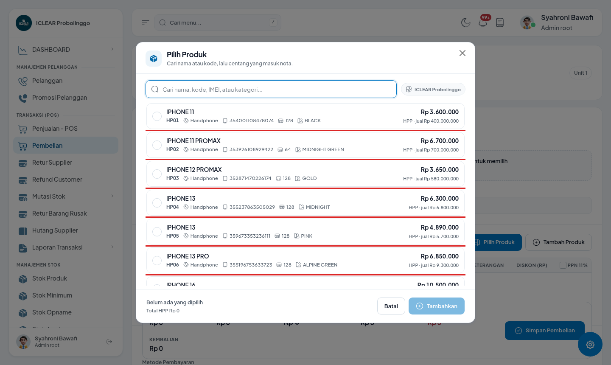
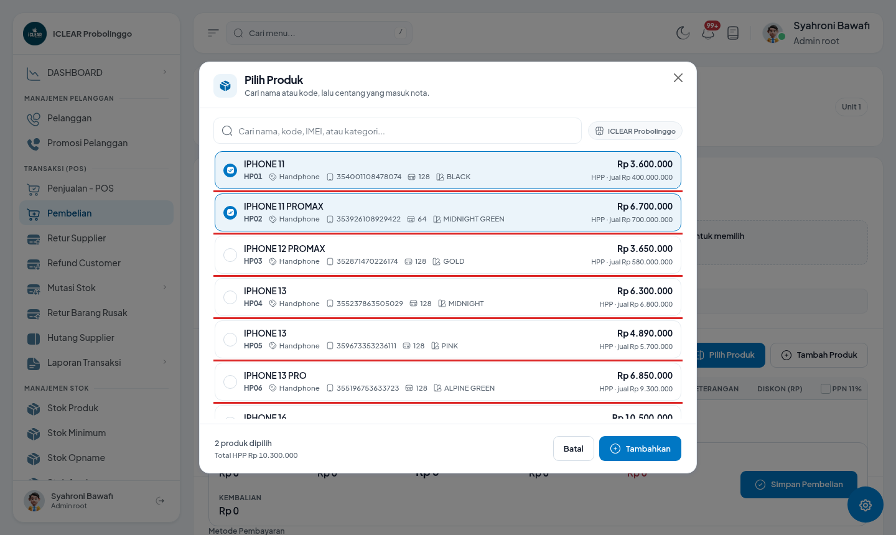
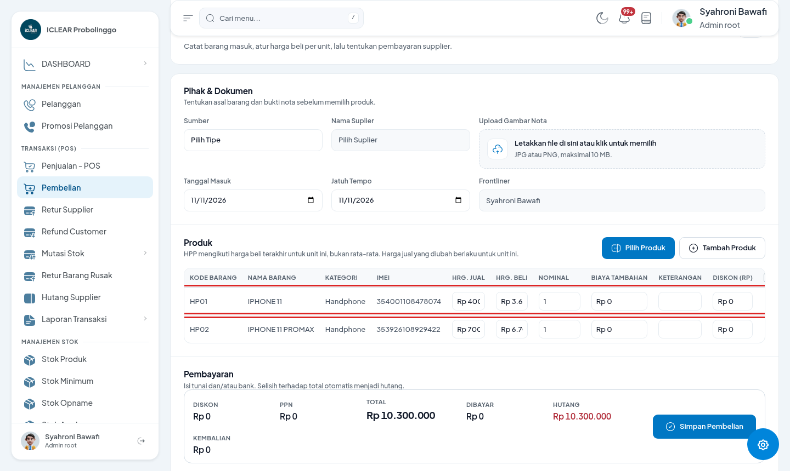
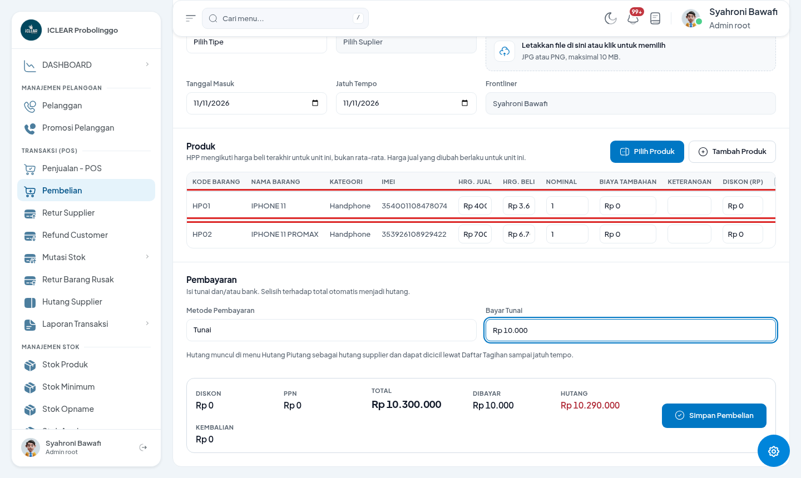
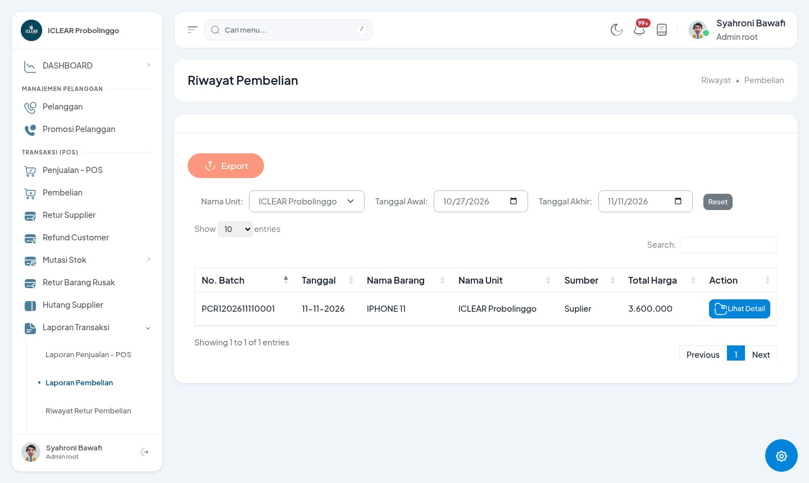
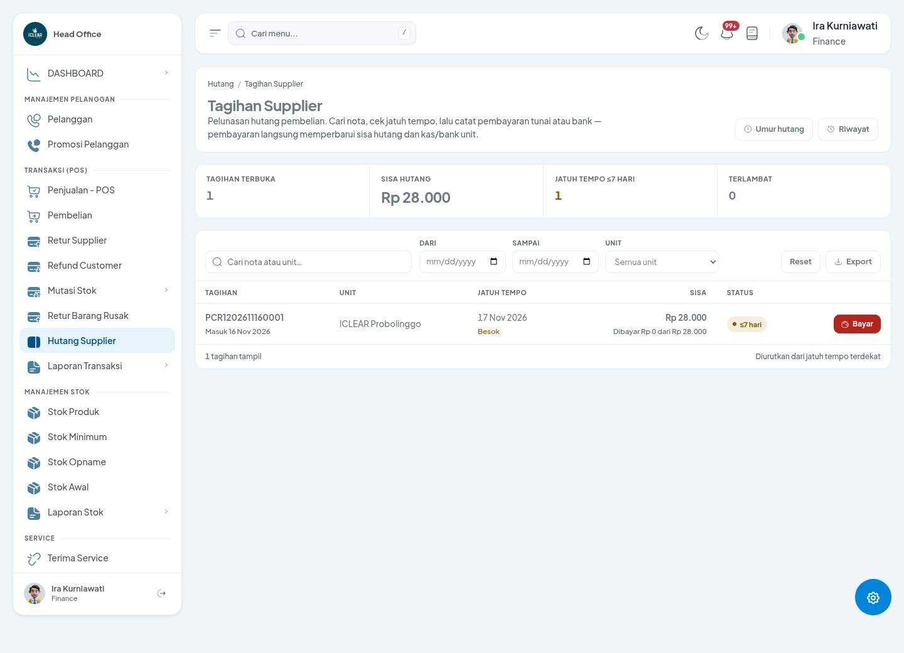
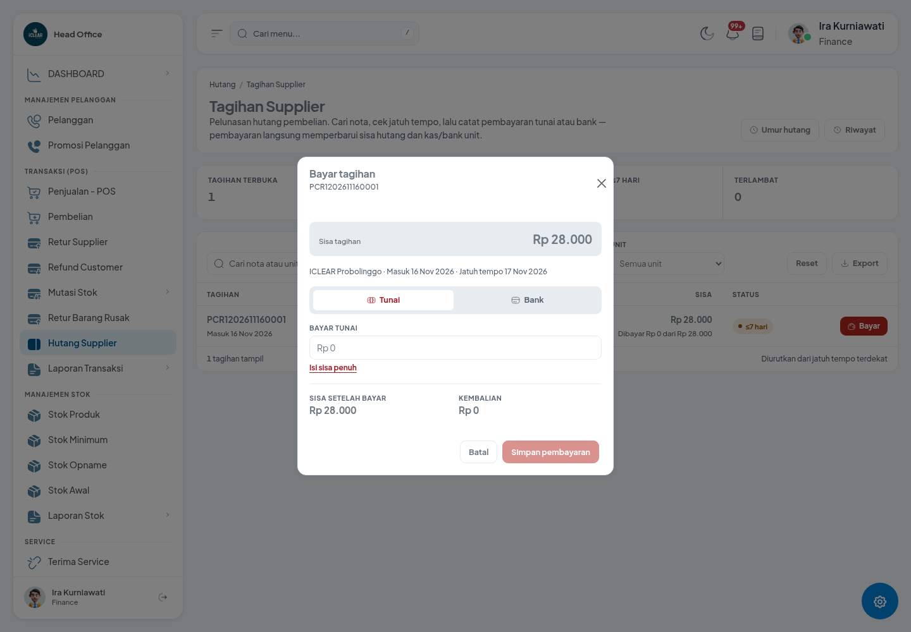
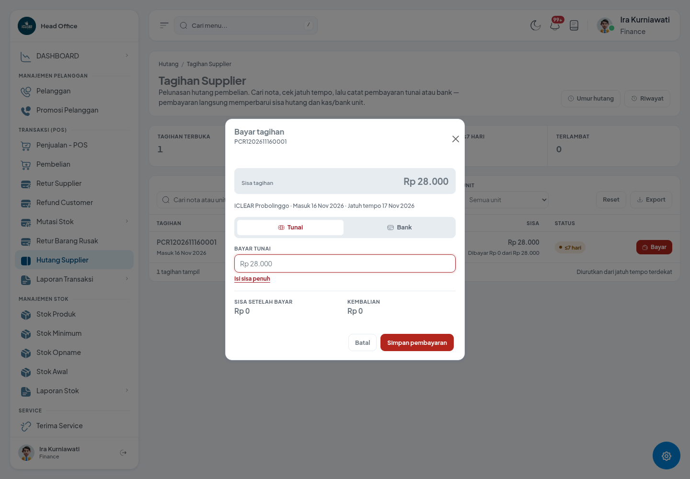

# Panduan Perubahan: Halaman Pembelian

- **Tanggal:** 11 November 2026
- **Diperbarui:** 16 November 2026 — tambahan panduan pembayaran pembelian sparepart baru
- **Untuk:** Staf gudang, admin pembelian, kepala toko
- **Berlaku untuk:** semua unit/cabang
- **Catatan gambar:** semua gambar diambil dari aplikasi asli (contoh: unit *ICLEAR Probolinggo*). Angka yang terlihat adalah data contoh.

---

## 1. Apa yang berubah?

Halaman **Pembelian** (menu Transaksi (POS) → Pembelian) dirapikan dan beberapa hal sekarang otomatis:

| Hal | Sebelum | Sesudah |
|---|---|---|
| HPP unit produk | Sama untuk semua unit / perlu diatur manual | **Otomatis** mengikuti harga beli terakhir di unit pembelian |
| Frontliner | Dipilih manual | **Otomatis** mengikuti akun yang login (tidak bisa diedit) |
| Harga jual produk | Pembelian bisa menimpa harga master produk | Harga jual diatur **per unit**; harga master tidak berubah |
| Hutang supplier | Berkurang akurat saat pembayaran sebagian | Dihitung dari **total transaksi** dikurangi yang sudah dibayar — termasuk pembelian sparepart baru yang belum dibayar |
| Tampilan | Form panjang | Rapi per bagian: **Pihak & Dokumen**, **Produk**, **Pembayaran** |

---

## 2. Langkah input pembelian

### Langkah 1 — Isi data pembelian

Buka **Transaksi (POS) → Pembelian**, lalu isi:

- **Sumber / Nama Suplier** — pilih pihak (suplier) yang memasok barang.
- **Upload Gambar Nota** — foto/scan nota supplier (opsional).
- **Tanggal Masuk** dan **Jatuh Tempo** (jatuh tempo wajib diisi).
- **Frontliner** — sudah otomatis terisi sesuai akun yang login.

### Langkah 2 — Pilih produk

1. Klik **Pilih Produk**.
2. Cari produk (kode, nama, IMEI, atau kategori), lalu centang produk yang dibeli. Kartu produk menampilkan **HPP** dan **harga jual unit** saat ini.
3. Klik **Tambahkan**.

### Langkah 3 — Cek harga & isi nominal

Produk masuk ke tabel. Periksa/isi:

- **Hrg. Beli** — harga beli per unit (ini yang menentukan HPP unit setelah pembelian disimpan).
- **Nominal** — jumlah barang.
- **Biaya Tambahan**, **Keterangan**, **Diskon (Rp)** — sesuai nota.
- **Hrg. Jual** — hanya bisa diubah oleh role pengelola; berfungsi untuk mengatur harga jual produk di unit ini.

### Langkah 4 — Pembayaran

- Pilih **Metode Pembayaran** (tunai dan/atau bank).
- Isi nominal yang dibayar. **Selisih terhadap total otomatis menjadi hutang** — tidak perlu dihitung manual.
- **Kalau belum dibayar sama sekali**, biarkan nominal **Rp 0**. Seluruh total pembelian otomatis menjadi hutang supplier. Panduan pembayaran sparepart baru ada di [bagian 4](#4-pembelian-sparepart-baru-lunas-atau-jadi-hutang-supplier).

### Langkah 5 — Simpan

Klik **Simpan Pembelian**.

## 3. Setelah pembelian disimpan

- **HPP unit produk ikut ter-update otomatis** sesuai harga beli terakhir di unit ini — tidak perlu koreksi manual. Bisa dilihat di **Stok Produk → Kartu Stok**.
- Kalau kolom **Hrg. Jual** diisi/diubah, harga jual baru **langsung berlaku** di kasir (POS) dan Service untuk unit ini. Rinciannya ada di dokumen **Panduan Perubahan: HPP & Harga Jual per Unit**.
- Harga jual unit yang **sama dengan harga master** akan menghapus setelan khusus (kembali mengikuti master).
- **Pembelian sparepart baru yang belum lunas** otomatis tercatat sebagai hutang supplier dan muncul di menu **Hutang Supplier → Tagihan Supplier**.
- Riwayat pembelian bisa diperiksa di menu **Riwayat → Riwayat Pembelian** (ada filter per unit dan tanggal, plus tombol untuk lihat detail/export).

---

## 4. Pembelian sparepart baru: lunas atau jadi hutang supplier

Sparepart baru dibeli lewat menu yang sama, yaitu **Transaksi (POS) → Pembelian**. Pilih produk berkategori sparepart (bukan jasa), isi **Hrg. Beli** dan **Nominal** seperti pembelian biasa. Setelah disimpan, stok sparepart bertambah di unit pembelian dan HPP-nya ikut diperbarui.

Yang perlu diperhatikan adalah bagian **Pembayaran**, karena pembelian sparepart bisa dibayar penuh, sebagian, atau belum dibayar sama sekali.

### 4.1 Kalau dibayar penuh

Isi **Metode Pembayaran** (tunai dan/atau bank) dan nominal sebesar total pembelian. Setelah disimpan, status pembelian **Lunas** dan tidak ada tagihan yang muncul di menu Hutang Supplier.

### 4.2 Kalau dibayar sebagian atau belum dibayar

- **Belum dibayar sama sekali:** biarkan nominal pembayaran **Rp 0**. Seluruh total pembelian otomatis menjadi **hutang supplier**.
- **Dibayar sebagian:** isi nominal yang benar-benar dibayar sekarang. Sisa otomatis dihitung: **total − yang dibayar = hutang supplier**.
- **Jatuh tempo wajib diisi.** Tanggal ini menjadi dasar urutan tagihan dan umur hutang, jadi isi sesuai tempo yang disepakati dengan supplier.
- Status pembelian menjadi **Belum Lunas**, dan baris tagihannya muncul di **Hutang Supplier → Tagihan Supplier** (juga terlihat di **Hutang Piutang → Hutang**).

Contoh: total pembelian sparepart Rp 2.500.000, dibayar Rp 1.000.000. Sisa **Rp 1.500.000** tercatat sebagai hutang supplier dengan status **Belum Lunas**.

### 4.3 Cara membayar atau mencicil hutang sparepart

Semua pembayaran hutang supplier dilakukan dari menu **Hutang Supplier** (halaman **Tagihan Supplier**). Daftar ini menampilkan semua nota yang masih **Belum Lunas**, diurutkan dari jatuh tempo terdekat.

1. Buka menu **Hutang Supplier**.
2. Cari nota pembeliannya, atau gunakan filter tanggal dan unit.
3. Klik **Bayar** pada baris tagihan.
4. Pilih **Tunai** atau **Bank**. Untuk pembayaran bank, pilih rekening yang muncul — daftar rekening mengikuti unit dan hak akses akun.
5. Isi nominal pembayaran. Gunakan **Isi sisa penuh** kalau ingin melunasi seluruh sisa sekaligus.
6. Periksa **Sisa setelah bayar**, lalu klik **Simpan pembayaran**.
7. Kalau sisa sudah **Rp 0**, status tagihan berubah menjadi **Lunas** dan barisnya hilang dari daftar. Kalau belum, sisa tetap muncul untuk dicicil lagi.

#### 4.3.1 Pelunasan sekaligus (sisa menjadi Rp 0)

Gunakan cara ini kalau ingin melunasi seluruh sisa hutang sparepart dalam satu pembayaran.

1. Buka **Hutang Supplier**, lalu klik **Bayar** pada tagihan yang ingin dilunasi.
2. Klik **Isi sisa penuh**. Nominal pembayaran otomatis terisi sebesar sisa tagihan.
3. Pilih **Tunai** atau **Bank**. Kalau memilih **Bank**, pilih rekening yang dipakai.
4. Pastikan angka **Sisa setelah bayar** menunjukkan **Rp 0**.
5. Klik **Simpan pembayaran**.
6. Tagihan berubah menjadi **Lunas** dan hilang dari daftar Tagihan Supplier.

#### 4.3.2 Cicilan sebagian (sisa masih ada)

1. Buka **Hutang Supplier**, lalu klik **Bayar** pada tagihan.
2. Pilih **Tunai** atau **Bank**, lalu isi nominal yang dibayar sekarang (lebih kecil dari sisa).
3. Periksa **Sisa setelah bayar** — nilainya masih lebih dari **Rp 0**.
4. Klik **Simpan pembayaran**. Status tagihan tetap **Belum Lunas**.
5. Ulangi langkah yang sama saat membayar cicilan berikutnya sampai sisanya **Rp 0**.

Satu pembayaran memakai satu metode (tunai **atau** bank). Kalau perlu membayar dengan dua metode, catat sebagai dua kali pembayaran. Kalau tombol **Bank** tidak aktif, gunakan **Tunai** atau minta admin menambahkan rekening bank yang bisa dipakai unit ini.

### 4.4 Yang perlu diingat

- **Catat pembayaran lewat menu Hutang Supplier**, bukan hanya dicatat manual. Lewat menu ini sisa hutang pada nota dan riwayat pembayaran ikut diperbarui.
- **Jangan mengubah total pembelian** untuk menghapus hutang. Kalau sudah terlanjur salah input, hubungi admin/keuangan untuk penanganan yang benar.
- Pembelian sparepart yang **sudah lunas** tidak muncul lagi di daftar tagihan. Kalau masih muncul, periksa apakah nominal pembayaran benar-benar menutup seluruh sisa.
- **Pilih Tunai atau Bank sesuai sumber dana.** Kalau lewat bank, pilih rekening yang dipakai; daftar rekening mengikuti unit dan hak akses akun.

---

## 5. Catatan penting

- **Hutang supplier dihitung dari total transaksi.** Contoh: total Rp 10.300.000, dibayar Rp 10.000 → hutang Rp 10.290.000. Pembayaran cicilan berikutnya mengurangi hutang tersebut, dan sisa hutang bisa dicek lewat menu **Hutang Supplier** (termasuk cetak Daftar Tagihan sesuai jatuh tempo).
- **Frontliner** mengikuti akun yang login, jadi pembelian tercatat atas nama pemakai yang benar. Pastikan login memakai akun masing-masing.
- **Harga master produk tidak lagi ditimpa** oleh pembelian. Harga jual per unit diatur lewat kolom Hrg. Jual (atau Kartu Stok/Tarif Jasa).
- Hanya role pengelola (Finance, Admin root, Manager, Admin/Kasir, Kepala Toko) yang bisa mengubah kolom **Hrg. Jual**. Bagi role lain, kolom tampil hanya untuk dibaca.

## 6. FAQ singkat

**Beli sparepart baru tapi belum dibayar, apakah tetap bisa disimpan?**
Bisa. Isi nominal pembayaran **Rp 0** dan isi **Jatuh Tempo**. Seluruh total pembelian akan tercatat sebagai hutang supplier dengan status **Belum Lunas**.

**Sudah transfer ke supplier, kenapa hutang sparepart masih muncul?**
Pembayaran harus dicatat lewat menu **Hutang Supplier → Tagihan Supplier → Bayar**. Kalau hanya dicatat manual atau lewat menu lain, sisa hutang di sistem tidak ikut berkurang.

**Bagaimana cara melunasi seluruh sisa hutang sparepart?**
Buka **Hutang Supplier → Bayar → Isi sisa penuh**, pastikan **Sisa setelah bayar** menunjukkan **Rp 0**, lalu klik **Simpan pembayaran**. Tagihan berubah **Lunas** dan hilang dari daftar (lihat bagian 4.3.1).

**Kolom Hrg. Jual tidak bisa diedit?**
Akun kamu belum termasuk role pengelola. Harga jual akan memakai nilai yang sudah ada untuk unit ini.

**HPP produk tidak berubah setelah pembelian?**
HPP mengikuti harga beli terakhir **di unit pembelian**. Cek di Kartu Stok pada unit yang sama.

**Frontliner terisi nama orang lain?**
Frontliner otomatis dari akun yang login. Kalau namanya beda, berarti akun tersebut yang sedang dipakai — hubungi admin.

**Bisa bayar sebagian lalu cicil nanti?**
Bisa. Selisihnya jadi hutang, dan cicilan dibayar dari menu **Hutang Supplier → Tagihan Supplier → Bayar** (lihat bagian 4).

**Nota fisik sudah dibuang, bisa input tanpa upload?**
Bisa — upload gambar nota opsional. Tapi sebaiknya selalu lampirkan nota agar mudah diaudit.

---

*Dokumen terkait: **Panduan Perubahan: HPP & Harga Jual per Unit** (`2026-11-11-hpp-dan-harga-jual-per-unit.md`) untuk aturan HPP dan harga jual per unit.*
