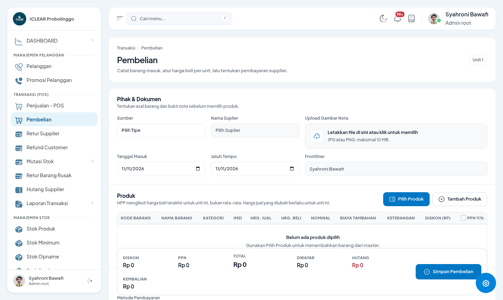
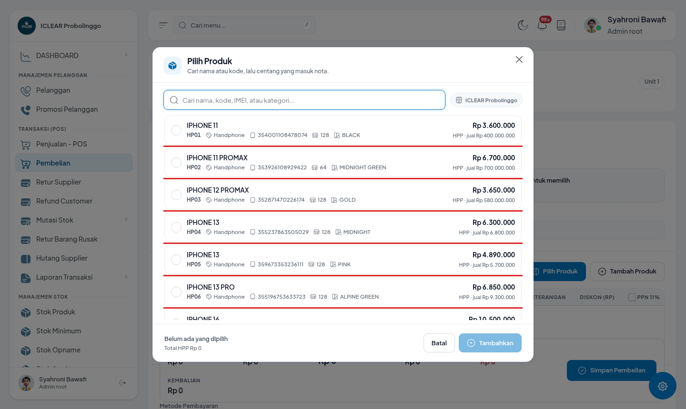
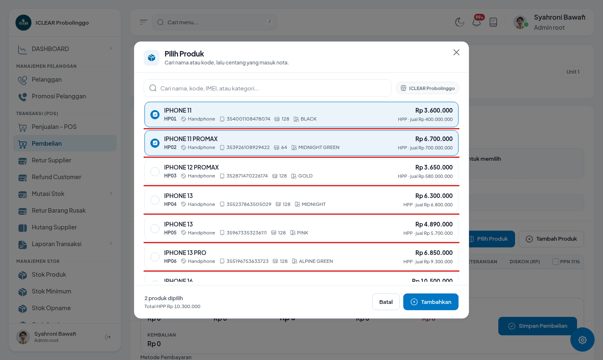
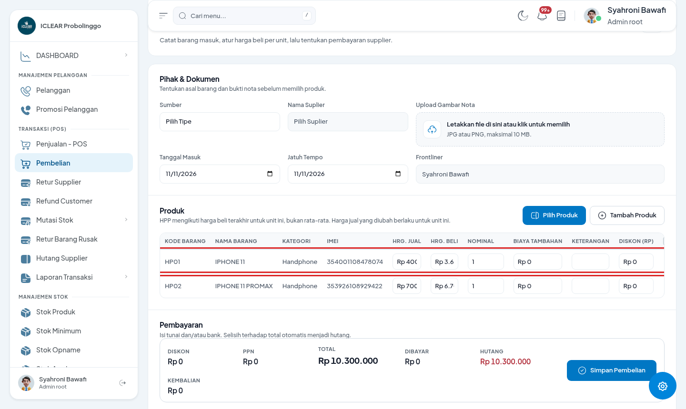
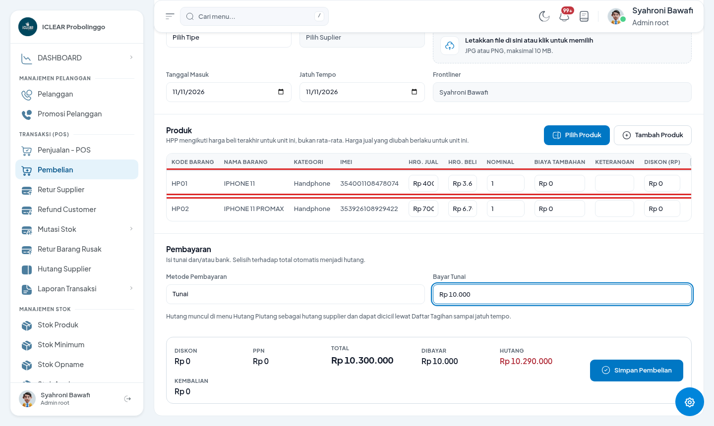
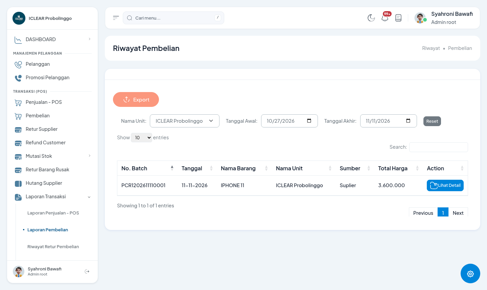

# Panduan Perubahan: Halaman Pembelian

- **Tanggal:** 11 November 2026
- **Untuk:** Staf gudang, admin pembelian, kepala toko
- **Berlaku untuk:** semua unit/cabang
- **Catatan gambar:** semua gambar diambil dari aplikasi asli (contoh: unit *ICLEAR Probolinggo*). Angka yang terlihat adalah data contoh.

---

## 1. Apa yang berubah?

Halaman **Pembelian** (menu Transaksi (POS) → Pembelian) dirapikan dan beberapa hal sekarang otomatis:

| Hal | Sebelum | Sesudah |
|---|---|---|
| HPP unit produk | Sama untuk semua unit / perlu diatur manual | **Otomatis** mengikuti harga beli terakhir di unit pembelian |
| Frontliner | Dipilih manual | **Otomatis** mengikuti akun yang login (tidak bisa diedit) |
| Harga jual produk | Pembelian bisa menimpa harga master produk | Harga jual diatur **per unit**; harga master tidak berubah |
| Hutang supplier | Berkurang akurat saat pembayaran sebagian | Dihitung dari **total transaksi** dikurangi yang sudah dibayar |
| Tampilan | Form panjang | Rapi per bagian: **Pihak & Dokumen**, **Produk**, **Pembayaran** |

---

## 2. Langkah input pembelian

### Langkah 1 — Isi data pembelian

Buka **Transaksi (POS) → Pembelian**, lalu isi:

- **Sumber / Nama Suplier** — pilih pihak (suplier) yang memasok barang.
- **Upload Gambar Nota** — foto/scan nota supplier (opsional).
- **Tanggal Masuk** dan **Jatuh Tempo**.
- **Frontliner** — sudah otomatis terisi sesuai akun yang login.

### Langkah 2 — Pilih produk

1. Klik **Pilih Produk**.
2. Cari produk (kode, nama, IMEI, atau kategori), lalu centang produk yang dibeli. Kartu produk menampilkan **HPP** dan **harga jual unit** saat ini.
3. Klik **Tambahkan**.

### Langkah 3 — Cek harga & isi nominal

Produk masuk ke tabel. Periksa/isi:

- **Hrg. Beli** — harga beli per unit (ini yang menentukan HPP unit setelah pembelian disimpan).
- **Nominal** — jumlah barang.
- **Biaya Tambahan**, **Keterangan**, **Diskon (Rp)** — sesuai nota.
- **Hrg. Jual** — hanya bisa diubah oleh role pengelola; berfungsi untuk mengatur harga jual produk di unit ini.

### Langkah 4 — Pembayaran

- Pilih **Metode Pembayaran** (tunai dan/atau bank).
- Isi nominal yang dibayar. **Selisih terhadap total otomatis menjadi hutang** — tidak perlu dihitung manual.

### Langkah 5 — Simpan

Klik **Simpan Pembelian**.

## 3. Setelah pembelian disimpan

- **HPP unit produk ikut ter-update otomatis** sesuai harga beli terakhir di unit ini — tidak perlu koreksi manual. Bisa dilihat di **Stok Produk → Kartu Stok**.
- Kalau kolom **Hrg. Jual** diisi/diubah, harga jual baru **langsung berlaku** di kasir (POS) dan Service untuk unit ini. Rinciannya ada di dokumen **Panduan Perubahan: HPP & Harga Jual per Unit**.
- Harga jual unit yang **sama dengan harga master** akan menghapus setelan khusus (kembali mengikuti master).
- Riwayat pembelian bisa diperiksa di menu **Riwayat → Riwayat Pembelian** (ada filter per unit dan tanggal, plus tombol untuk lihat detail/export).

---

## 4. Catatan penting

- **Hutang supplier dihitung dari total transaksi.** Contoh: total Rp 10.300.000, dibayar Rp 10.000 → hutang Rp 10.290.000. Pembayaran cicilan berikutnya mengurangi hutang tersebut, dan sisa hutang bisa dicek lewat menu **Hutang Supplier/Piutang** (termasuk cetak Daftar Tagihan sesuai jatuh tempo).
- **Frontliner** mengikuti akun yang login, jadi pembelian tercatat atas nama pemakai yang benar. Pastikan login memakai akun masing-masing.
- **Harga master produk tidak lagi ditimpa** oleh pembelian. Harga jual per unit diatur lewat kolom Hrg. Jual (atau Kartu Stok/Tarif Jasa).
- Hanya role pengelola (Finance, Admin root, Manager, Admin/Kasir, Kepala Toko) yang bisa mengubah kolom **Hrg. Jual**. Bagi role lain, kolom tampil hanya untuk dibaca.

## 5. FAQ singkat

**Kolom Hrg. Jual tidak bisa diedit?**
Akun kamu belum termasuk role pengelola. Harga jual akan memakai nilai yang sudah ada untuk unit ini.

**HPP produk tidak berubah setelah pembelian?**
HPP mengikuti harga beli terakhir **di unit pembelian**. Cek di Kartu Stok pada unit yang sama.

**Frontliner terisi nama orang lain?**
Frontliner otomatis dari akun yang login. Kalau namanya beda, berarti akun tersebut yang sedang dipakai — hubungi admin.

**Bisa bayar sebagian lalu cicil nanti?**
Bisa. Selisihnya jadi hutang, dan cicilan bisa dibayar dari menu Hutang Supplier/Piutang.

**Nota fisik sudah dibuang, bisa input tanpa upload?**
Bisa — upload gambar nota opsional. Tapi sebaiknya selalu lampirkan nota agar mudah diaudit.

---

*Dokumen terkait: **Panduan Perubahan: HPP & Harga Jual per Unit** (`2026-11-11-hpp-dan-harga-jual-per-unit.md`) untuk aturan HPP dan harga jual per unit.*
